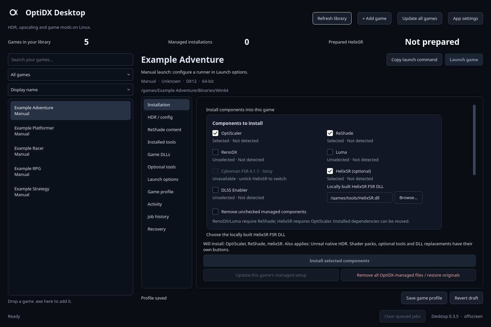

# OptiDX Desktop

**A native Linux desktop app for managing HDR mods, upscalers, ReShade and game DLLs.**

Find your games, choose the components you want, install them before playing, and manage updates and recovery from one interface.

> Looking for the original launch script? **[Cha1N1/OptiDX](https://github.com/Cha1N1/OptiDX) remains the script-only project.** OptiDX Desktop is developed separately and includes its own adapted backend. You do not need to install the old script to use Desktop.



*Interface preview with a sample library. Dark is the default; Light and System colors are also available.*

## What’s new in 0.3.5

- **Refreshed interface:** white accents on near-black blue, a matching header icon, clearer spacing and consistent controls.
- **Standalone HelixSR:** choose your locally built x64 DLL with the compact Browse field. No separate weights or kernels are needed. HelixSR and Cyboman FSR are mutually exclusive, with visible explanations for disabled choices.
- **Visible maintenance actions:** update and uninstall stay on the main Installation page.
- **Faster AppImage startup:** gzip packaging and less repeated work before the window appears.
- **Smoother navigation:** accelerated scrolling, short transitions, retained drafts and Dark / Light / System appearance options.

## Features

- **Game library:** discover Steam, Heroic, Lutris and Bottles installations, or add a Windows executable manually. Search, filter, favourite and rename entries; disconnected drives remain in the cached library.
- **Independent components:** choose OptiScaler, ReShade, RenoDX, Luma, Cyboman lossy FSR, optional HelixSR and DLSS Enabler. Review selected, detected, dependency and update status together.
- **ReShade content:** manage shader packs, individual effects, addons and presets, including custom imports and shared profiles.
- **Game DLL management:** select DLSS/Streamline versions and exact target folders, with tracked originals and restore controls.
- **Linux launch profiles:** configure Wine/Proton/UMU runners, prefixes, arguments and environment overrides, plus optional Gamescope, vkBasalt, DXVK and KDE HDR controls.
- **Updates and recovery:** preview bulk updates, exclude games or components, inspect job logs and backups, and verify retained snapshots before restoring recorded files.
- **A persistent workspace:** per-game drafts, saved layouts, fast navigation, accelerated smooth scrolling and an optional reduced-motion mode.
- **Dark, Light or System:** use white accents on a near-black blue background, use a light palette, or follow your actual Qt colors, including custom KDE color schemes.

Optional tools include frame limiters, OptiPatcher, RE Framework, an eligible Unreal Engine DOF fix and experimental neural-rendering adapters. See [feature coverage and limitations](docs/RHI_PARITY.md) for the detailed breakdown.

## Download and run

### AppImage — recommended

Download `OptiDX-Desktop-0.3.5-x86_64.AppImage` and its `.sha256` file from [GitHub Releases](https://github.com/Cha1N1/OptiDX-Desktop/releases) when the 0.3.5 assets are published. Put both files in the same directory, then run:

```bash
sha256sum -c OptiDX-Desktop-0.3.5-x86_64.AppImage.sha256
chmod +x OptiDX-Desktop-0.3.5-x86_64.AppImage
./OptiDX-Desktop-0.3.5-x86_64.AppImage
```

If FUSE is unavailable:

```bash
./OptiDX-Desktop-0.3.5-x86_64.AppImage --appimage-extract-and-run
```

The AppImage bundles Python, Qt and the download/archive tools. Your graphics drivers, game launcher and Wine/Proton runner come from your system. Optional integrations such as Gamescope and vkBasalt require their host tools to be installed.

The GUI prefers **native Wayland** on Wayland sessions, with X11 fallback. Its footer shows the backend in use. A deliberate single-backend `QT_QPA_PLATFORM` override is respected.

Keep the AppImage at a stable location if you use it in game launch commands.

### Run from source

Requires **Python 3.10+**, PySide6, PyYAML, `curl`, `unzip` and a supported 7-Zip executable (`7z`, `7za` or `7zz`). From the source directory:

```bash
python3 -m venv .venv
source .venv/bin/activate
python3 -m pip install -r requirements.txt
./run.sh
```

For local AppImage builds and runtime provenance, see the [packaging guide](packaging/README.md).

## First setup

1. **Refresh library**, or use **Add game** / drag a Windows `.exe` onto the window.
2. Check the selected executable folder. For Unreal games, this is often `Binaries/Win64`; use **Change installation executable** if detection picked the wrong binary.
3. On **Installation**, choose your components and review the summary and dependency messages.
4. Configure any required prefix or runner under **Launch options**.
5. Click **Install selected components**. Follow progress in **Activity** and inspect results in **Job history**.
6. Launch through your usual launcher, or use the app's saved manual runner.

Opening the app and refreshing the library do not install mods or launch games. Installation and other management jobs do not start the game.

### What each action does

| Action | Scope |
| --- | --- |
| Save game profile | Saves choices; does not write game files. Unsaved drafts are retained separately. |
| Install selected components | Installs the checked core components and applies the HDR/FG settings listed in its summary. |
| HDR / config | Applies configuration without downloading core components. |
| ReShade content / Optional tools / Game DLLs | Each page has separate actions for its own content. Importing an asset stores it in the app library until you deploy it. |
| Update this game's managed setup | Refreshes selected core components and installed optional groups, respecting exclusions. |
| Update all games | Previews eligible games and queues checked entries using their saved profiles. |
| Remove all OptiDX-managed files / restore originals | Removes the managed setup and restores verified originals where available. |
| Recovery | Verifies and restores files recorded in a retained snapshot; this is separate from full removal. |

**Unchecked components stay installed by default.** Enable **Remove unchecked managed components** only when you want the installation reconciled to your selection. Unrelated user files are preserved.

RenoDX/Luma need selected or existing ReShade; HelixSR needs selected or existing OptiScaler. Dependencies are explained rather than silently selected.

### FSR and HelixSR

New profiles select **Cyboman lossy FSR** and leave **HelixSR off**. HelixSR and Cyboman cannot be selected together; untick the active choice before switching. The FSR component deploys the lossy upscaler DLL; it does not implicitly install ReShade, HDR addons or OptiScaler.

When HelixSR is checked, choose your locally built Windows x64 FSR DLL in the path field below it. Current HelixSR builds need only the DLL; separate weights and kernels are not required. The DLL replaces `OptiScaler/amd_fidelityfx_upscaler_dx12.dll` directly, without renaming it to `helixsr.dll` or creating a HelixSR subfolder. A verified backup retains the replaced DLL. The path is saved per game and included in drafts; the app does not compile weights during game startup. Update and uninstall buttons are always visible on Installation. To switch an existing managed setup back to direct FSR, use **Installation → Remove HelixSR / restore previous AMD DLL**. This restores the replaced DLL when a verified backup exists; if no previous DLL existed, it removes HelixSR without inventing a replacement. Remove the managed HelixSR replacement before installing Cyboman. Restart the game after changing DLL routing.

### Launch settings

Steam/Heroic games launch through their owning launcher. **Launching through a store URI does not automatically apply the app's saved environment or HDR options.** Use the managed profile wrapper when you want those settings applied.

For Steam, use **Copy launch command** and paste it into the game's Steam Launch Options. The wrapper refers to the saved profile, so keep the AppImage and profile available. See the [packaging guide](packaging/README.md#use) for Heroic wrapper setup.

Manually added games can use a saved Wine, Proton or UMU runner and prefix. Bottles discovery and CLI launching are also supported.

## Backups and local data

Before deployment, the app takes verified snapshots of relevant files and retains ownership records for managed components. Failed operations attempt rollback; any recovery failures are reported with the retained backup locations.

**Recovery** checks snapshot targets and hashes before restoring recorded files. It retains newer unrecorded files and refuses restores that would lose newer ownership/journal data. Snapshot restore does not revert saved profiles or external HDR configuration. Use full setup removal for uninstalling managed components.

App data is stored in:

```text
$XDG_DATA_HOME/optidx-desktop
```

or, by default:

```text
~/.local/share/optidx-desktop
```

This contains the library cache, profiles, drafts, settings, job history, logs and backups. Download caches and prepared HelixSR assets use their existing OptiDX XDG locations. Personal library data, profiles and user-supplied DLLs are not included in the AppImage.

## Compatibility and current limits

This is an **early public release for Linux x86_64**. The full component stack targets **64-bit DX11/DX12 Windows games running through Wine/Proton**.

- Architecture-matched ReShade and RenoDX addons also cover supported DX9/OpenGL/32-bit cases; upscaler components do not have the same coverage.
- Graphics API detection can be inconclusive when a game loads libraries dynamically. A detected component means files were found, not that runtime compatibility has been verified.
- Wine ReShade Vulkan addon injection is not implemented. An installed native vkBasalt layer provides a separate Vulkan-effects option.
- Automatic desktop HDR switching currently targets KDE Plasma. Other compositor HDR adapters are not implemented.
- Hardware-dependent features, DLL replacements and neural-rendering adapters need compatible games, GPUs and runners. Neural deployment has fixture coverage, not broad gameplay validation; 32-bit neural helpers are unsupported.
- Windows driver-profile features such as RTX HDR and Smooth Motion are not implemented.
- Cross-distribution and older-CPU AppImage compatibility, every upstream live download source and actual gameplay compatibility have not been comprehensively validated.

Current validation includes **165 automated tests**, bundled-Python tests, temporary-folder deployment/recovery checks and native Wayland AppImage startup. These checks do not replace testing a particular game and mod combination. See [current feature status](docs/RHI_PARITY.md) and [release notes](RELEASE_NOTES.md).

## Troubleshooting and bug reports

- Check the display backend in the footer and the executable, API and architecture under **Installed components and diagnostics**.
- If a game uses the wrong binary, change its installation executable and refresh the details.
- If managed launch options have no effect, confirm the copied wrapper is configured in the launcher. Store URI launching alone uses the launcher's existing settings.
- After a failed job, inspect **Job history**, its log and the reported rollback result before retrying.

When opening an issue in this Desktop repository, include the app version, distribution/desktop, launcher, runner, game/API, affected component and the job error. **Copy diagnostics** can help; review the report and logs before posting, as they can contain local paths and saved environment values.

Please keep Desktop issues separate from reports for the [original script](https://github.com/Cha1N1/OptiDX).

## Development

```bash
python3 -B -m unittest discover -s tests -q
QT_QPA_PLATFORM=offscreen ./run.sh --data-dir /tmp/optidx-preview --screenshot /tmp/optidx-preview.png
```

The preview uses isolated app data and does not scan or modify games. Contributor guidance lives in [AGENTS.md](AGENTS.md); architecture and durable decisions are recorded in [project context](docs/PROJECT_CONTEXT.md).

For source/release separation and upload steps, see [publishing the Desktop project](docs/PUBLISHING.md).

## Credits and license

OptiDX Desktop includes an independently adapted OptiDX backend and a workflow inspired by [RHI](https://github.com/RankFTW/RHI). It is built with [Qt for Python / PySide6](https://doc.qt.io/qtforpython-6/).

Thanks to the authors of [OptiScaler](https://github.com/optiscaler/OptiScaler), [ReShade](https://reshade.me/), [RenoDX](https://github.com/clshortfuse/renodx), [Luma](https://github.com/Filoppi/Luma-Framework), [Cyboman FSR overrides](https://github.com/zgauthier2000/fsr4-shader-performance-overrides), and the other supported tools and addons.

Licensed under [GPL-3.0](LICENSE). Third-party components retain their own licenses. Backend provenance is recorded in [the original snapshot](backend/UPSTREAM_SNAPSHOT.json) and [Desktop backend changes](backend/SNAPSHOT.json).
